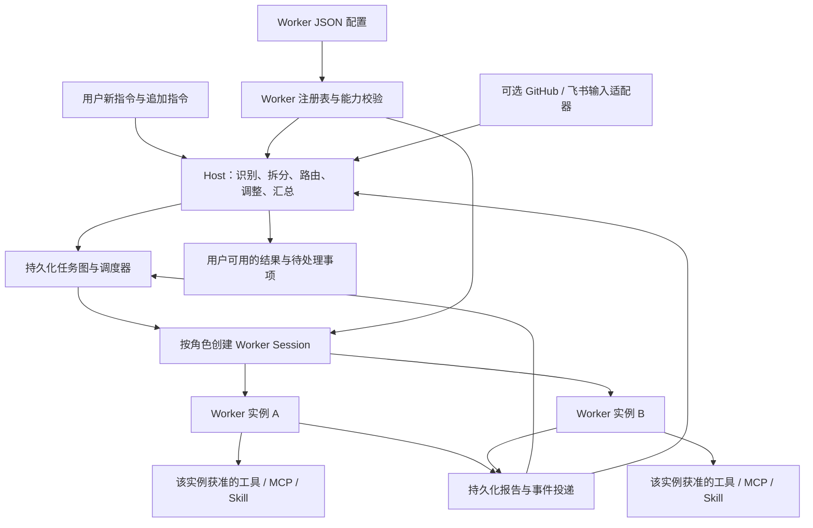

# 通用 Host / Worker 架构实施计划

## 目标

将项目的主要运行路径改成通用任务编排：用户持续向 Host 下达指令，Host 识别目标、拆分任务、选择 Worker，运行时按照依赖和并发限制执行；Worker 将进度、结果和产物回传，Host 据此继续调度、处理新指令并向用户交付。

领域知识由 Worker 配置、提示词、工具、MCP 和 Skill 提供。新增安全分析或 Coding 角色应通过编辑配置完成，不需要修改调度器。GitHub、飞书作为可选输入适配器接入。

## 当前基线

当前工作区已有初步实现，应在这些改动上继续完善：

| 能力 | 当前状态 | 主要位置 |
| --- | --- | --- |
| Worker JSON 配置、默认空白名单、按角色并发限制 | 已有实现；另有 Coding 与安全分析模板 | `src/tasks/workers.ts`、`examples/workers*.json` |
| 持久化任务图、依赖校验、状态转换 | 已有实现 | `src/tasks/model.ts`、`src/tasks/engine.ts` |
| Worker Session 启动、追加指令、取消、重试、恢复入口 | 已有初步实现 | `src/executor/tasks.ts` |
| Host / Worker 任务工具 | 已有实现 | `src/app/tools/tasks.ts` |
| 独立 Task Worker preset、工具白名单及逐调用检查 | 已实现；真实 DSH 工具 schema、MCP/Skill/本地注入越权检查通过 | `src/app/sessions.ts`、`cordis.patch.yml`、`tests/runtime.spec.ts` |
| 通用 Host 提示词 | 已独立于 GitHub / Ticket 上下文 | `src/app/sessions.ts`、`src/app/prompts.ts` |
| Worker 报告自动送达 Host | 已实现，报告和 relay 事件同事务持久化 | `src/executor/tasks.ts`、`src/app/runtime.ts` |
| 无 GitHub / 飞书配置时的报告投递 | 已启动 Effects 队列，通用任务可独立运行 | `src/app/runtime.ts` |
| 本地 Skill 可用性及授权隔离 | 已恢复 task-worker Skill provider，并按 profile 精确加载 | `src/executor/tasks.ts`、`cordis.patch.yml` |

以上“已有实现”不代表已经完成真实模型端到端验收。

## 目标结构与职责



- **Host** 使用 Worker 的职责说明和可用能力摘要选择角色，生成带依赖、验收条件和工作目录的结构化任务。没有匹配角色或必要能力时，明确报告阻塞。
- **TaskEngine** 校验任务图并管理状态、版本、依赖和并发。模型不能绕过这些检查直接启动任意角色。
- **TaskRunner / Session 工厂** 按有效配置创建实例、装配能力、投递任务并管理运行生命周期。
- **Worker** 执行分配的任务，提交证据、产物引用和报告。角色提示词及 Skill 内容不能扩大权限。
- **报告投递层** 可靠地将状态变化送到 Host，使其能够响应完成、失败、阻塞及后续用户指令。

## 配置约定

第一版继续使用 `<stateDir>/workers.json`，保留现有 `version: 1`、`profiles` 和各角色字段，避免另起一套不兼容配置。

```json
{
  "version": 1,
  "profiles": [
    {
      "id": "backend-coder",
      "name": "Backend coder",
      "description": "负责服务端接口、业务逻辑和持久化实现",
      "maxInstances": 2,
      "permissionPreset": "workspace-write",
      "tools": ["read", "write", "edit", "glob", "grep"],
      "mcps": [],
      "skills": [],
      "prompt": "按任务验收条件执行，报告修改内容及验证结果。"
    },
    {
      "id": "code-reviewer",
      "name": "Code reviewer",
      "description": "审查实现并提交有证据的问题列表",
      "maxInstances": 1,
      "permissionPreset": "read-only",
      "tools": ["read", "glob", "grep"],
      "mcps": [],
      "skills": []
    }
  ]
}
```

- `profiles` 的条目数决定角色种类，`maxInstances` 决定该角色跨所有任务图的最大并发实例数。实例按需启动。
- `tools`、`mcps`、`skills` 省略或为空时，不授予对应业务能力。`task_report` 是运行时保留的报告通道；仅配置 Skill 时提供 `task_skill`。
- MCP 按服务器和工具逐项授权，例如 `{"server":"repo-index","tools":["lookup_symbol"]}`；不能因列出服务器就获得整个服务器的工具。
- 配置只引用已经安装、注册且在目标作用域可用的能力，不自动安装插件或启动 MCP 服务。首版在任务启动前明确拒绝不可用的配置能力。
- 首版修改角色配置后重启生效；追加任务、修改待执行任务、指挥运行中的 Worker 则在运行时生效。配置热更新作为后续增强，届时为每次运行保存配置版本和有效授权快照。

## 实施顺序与验收

| 顺序 | 工作 | 交付与验收 |
| --- | --- | --- |
| 1. 通用 Host 独立启动 | **已完成**：Host prompt 与 Source 上下文拆开，Effects 独立启动并保留 Source gate。 | 无 GitHub / 飞书配置可接收普通任务并启动 Worker。 |
| 2. 补齐报告闭环 | **已完成**：progress、完成、失败、阻塞、启动失败和异常结束均写入报告并 relay；同事务持久化、稳定事件 ID。 | 依赖自动启动，投递失败可重试，重启不静默丢报告。 |
| 3. 完成能力隔离 | **已完成**：DSH schema 纯 JSON 化，工具/MCP/Skill/本地注入工具均按白名单检查。 | run5 真实模型越权验收通过；run6 重启后白名单与拒绝检查仍通过。 |
| 4. 完善任务调整与恢复 | **已完成首版**：编辑、追加指令、取消、重试、容量释放、依赖 artifacts 和后台作业清理已覆盖。 | run6 真实进程重启后继续同一 run，送达持久化指令并完成下游；异步启动与取消投递边界有回归测试。 |
| 5. 交付领域模板 | **已完成初版**：Coding 五角色、安全分析六角色和通用示例已加入。 | 编辑 JSON 即可替换领域角色，无需修改调度器。 |
| 6. 本机 DSH 端到端验收 | **已完成首版**：run5 路由/追加指令/权限闭环、run6 真实重启恢复、run7 Coding 并行实现与依赖审查均通过。 | Coding 产物经实际导入执行验证；210 项定向测试、类型检查和构建通过。 |

步骤 1、2 优先解决执行闭环；步骤 3、4 是对“未提供则无法访问”和“实时更新任务”的关键验收；步骤 5、6 完成可复用交付。

### 权限边界

工具白名单能限制运行时提供的接口，但允许任意 shell、通用文件读取或网络访问后，Worker 仍可能通过这些能力间接读取本地 Skill 文件、调用程序或访问服务。因此不能把接口白名单描述成完整的操作系统隔离。

对于“未提供则完全无法访问”的严格要求，需同时采用受限执行环境：将文件、网络、可执行程序和凭据限定到该 Worker 的范围；不需要通用 shell 的角色不授予 shell。MCP 凭据不进入其他 Worker 的环境。第一版先把运行时直接授权边界验证完整，严格环境隔离作为单独的运行后端交付和验收，不能在尚未实现时宣称已满足。

### 任务更新语义

- 待执行任务允许修改角色、描述、依赖及验收条件，并重新校验任务图。
- 运行中的任务通过持久化指令调整方向；切换角色采用取消原运行并创建新运行，不能在旧 Session 中直接扩权。
- 已完成结果需要重做时，保留原结果并创建后续任务；下游是否重做由 Host 显式调整计划。
- 每次重试保留新的运行标识，报告校验有效运行身份。
- 默认使用独立任务工作目录；需要共享项目的 Coding 任务必须显式约定共享目录，并避免多个写任务同时修改冲突资源。

### 端到端验收场景

1. 不配置 GitHub / 飞书，用户输入普通任务，Host 选择已配置角色并开始执行。
2. 两个独立任务并行执行，依赖它们的审查任务在两者完成后开始，并获得上游产物引用。
3. 多个任务图竞争同一角色时，实际并发不超过 `maxInstances`；失败或取消后及时释放容量。
4. 用户在执行中追加要求，Host 更新目标任务，Worker 收到且恢复后仍保留这条指令。
5. 分别验证允许及禁止的普通工具、MCP 工具和 Skill；包括本地注册工具和恢复后的 Session。
6. Worker 完成、失败、阻塞或未报告就结束时，Host 自动收到相应事件并可继续处理。
7. 在任务执行或报告投递中途重启，验证状态恢复、事件重试、去重及过期报告拒绝。
8. 替换领域配置后，同一调度内核能够运行 Coding 与本地测试样本分析流程。

## 交付边界

首个里程碑交付 JSON 可编辑配置、通用 Host、任务图、按角色执行与授权、持续指挥、报告回传及重启恢复。可视化角色编辑器、配置热更新、多机 Worker 和容器运行后端分开推进，避免混入核心执行流的首轮验收。

## 本机验证记录

测试环境为 Windows、本机 DSH `0.2.1-rc.5`、Node `24.16.0`，模型路由 `opencode-go / deepseek-v4.1-flash`。所有实例使用独立状态、Session、存储和工作目录，端口为 `3187`。

| 证据 | 已验证内容 |
| --- | --- |
| run5：`task-flow-e2e-20261104/run5/result.json` | 无 Source 配置时，真实 Host 创建两个依赖任务；analyst 成功读取样本、加载获准 Skill 和调用获准 MCP；执行中收到 `USER_UPDATE_42`；reviewer 自动执行；Host 收到两份报告；禁止的 MCP、Skill、写入、本地注入工具均被拒绝。 |
| run6：`task-flow-e2e-20261104/run6/recovery-result.json` | 在 MCP 调用等待时中断进程，等待原进程的锁过期后重启；同一 run/Session、attempt 1 继续执行，持久化的 `RECOVERY_73` 指令被送达；最终报告包含原证据和追加标记，下游审查完成；恢复后权限检查通过。 |
| run7：`task-flow-e2e-20261104/run7/coding-result.json` | 从五角色 Coding 模板创建目录，真实 Host 分派 backend/web 两项并行实现，审查任务依赖两者完成后启动；生成的模块经 Node 实际导入，验证 `sum(7,5)=12`、`sum(-3,2)=-1` 和 `<output>12</output>`；三项任务及 Host 汇总完成。 |
| 单元与 Runtime 回归 | 覆盖全图并发容量、依赖失败多级传播、重试、失效报告、报告事务回滚、投递失败后重启补送、任务取消与后台作业清理、启动期间追加指令和取消期间投递授权。 |

上述运行证据保存在本机 `.artifacts/` 下，原始配置和日志不纳入版本控制。验证使用本地样本与 MCP fixture，不代表已经对任何外部安全目标进行测试。

最终定向检查：

```sh
pnpm exec vitest run tests/runtime.spec.ts tests/tasks.spec.ts tests/tools.spec.ts tests/docs.spec.ts tests/bundle-patch.spec.ts tests/deployment-path.spec.ts tests/runtime-concurrency.spec.ts
pnpm typecheck
pnpm build
```

结果为 7 个测试文件、210 项测试通过，类型检查和构建通过。此处记录的是相关定向回归，不将仓库全量测试中的既有 Windows 环境问题记作已解决。
